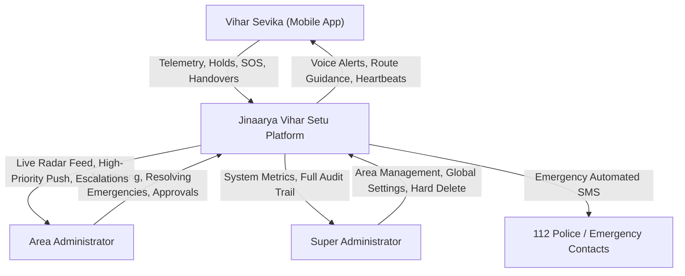
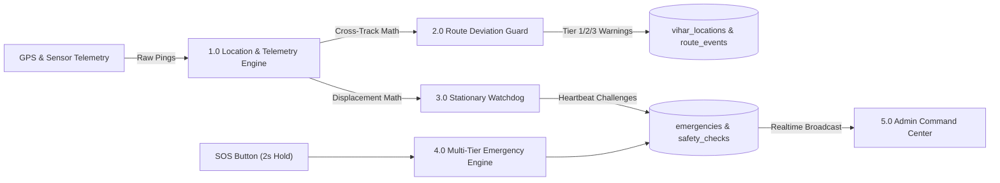
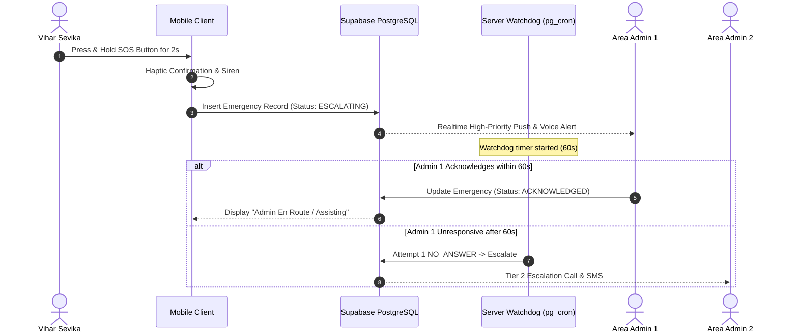
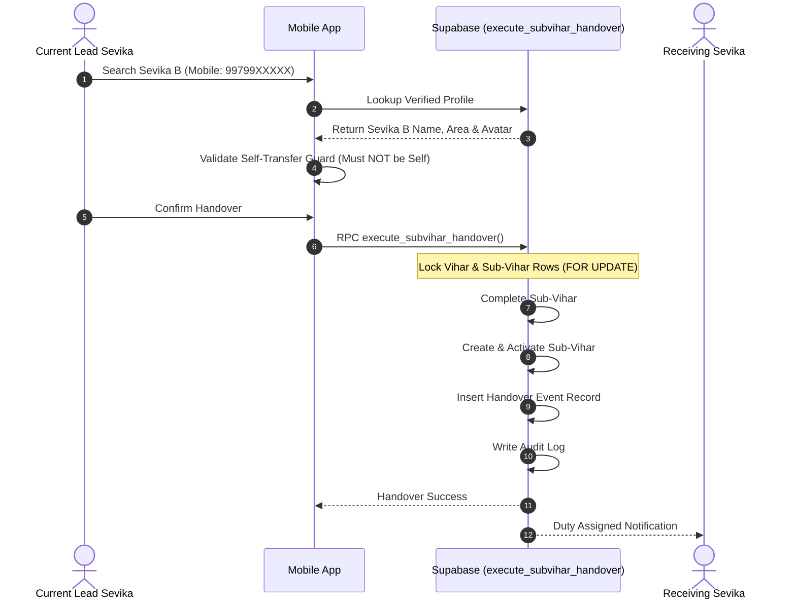

# JINAARYA VIHAR SETU — MASTER'S THESIS & TECHNICAL DOCUMENTATION
**Project Title:** JINAARYA VIHAR SETU — An Offline-First, Deterministic Life-Safety & Real-Time Coordination Architecture for Jain Sadhvijis and Accompanying Women Sevikas  
**Operating Body:** Jinaarya Vihar Seva  
**Academic Degree:** Master of Science / Technology in Computer Science & Mobile Systems Engineering  
**Version:** 3.0.0 (Production Release)  
**Primary Pilot Area:** Surat, Gujarat, India  

---

## 1. Executive Summary & Problem Statement

### 1.1 Context
In Jain tradition, monks and nuns (*Sadhus* and *Sadhvijis*) observe strict vows of renunciation. Among these is **Vihar**—the mandatory practice of travelling exclusively on foot between cities, villages, and pilgrimage sites (*Tirthas*). Jain Sadhvijis do not use motorized transport, do not travel after sunset, and do not possess personal mobile phones or money. 

To safeguard Sadhvijis from road hazards, harassment, medical distress, and route disorientation, lay women from the Jain community (*Vihar Sevikas / Shravikas*) accompany them on foot during early morning hours (typically starting 05:00 AM).

### 1.2 The Problem
Historically, this accompaniment was entirely uncoordinated:
1. **Zero Real-Time Visibility:** Neither local community leaders nor families knew whether a walking group was safe, off-route, or stationary due to injury.
2. **Aggressive Cellular Blackspots:** Walking routes frequently pass rural highways and bypasses where cellular data drops completely.
3. **Android Platform Fragility:** Modern mobile operating systems terminate background location services aggressively to conserve battery.
4. **Sub-Vihar Volunteer Churn:** A 15 km journey is rarely walked by one Sevika. Volunteer groups rotate in shifts (*Sub-Vihars*). Standard consumer tracking apps create disjointed trips or lose accountability across handovers.

### 1.3 Solution: Jinaarya Vihar Setu
Jinaarya Vihar Setu is an enterprise, safety-critical mobile platform engineered with an **offline-first local database queue**, **deterministic cross-track route deviation guards**, a **server-side silence watchdog**, **one-touch police SOS**, **atomic Sub-Vihar duty transfer**, and a **Jain-inspired sacred visual design**.

---

## 2. 10 Critical Safety Scenarios & System Response

| Scenario # | Real-World Incident | Deterministic App & Server Behavior |
|---|---|---|
| **Scenario 1** | **Total Cellular Blackspot (No Data)** | App stores coordinates in local SQLite/AsyncStorage queue with client UUIDs. SOS triggers automated SMS fallback containing Google Maps link with last known coordinates to Admin & Emergency Contact. |
| **Scenario 2** | **Accidental Route Drift (> 100m)** | Cross-track Haversine algorithm triggers **Tier 1 Alert**: Gentle voice alert in Sevika's preferred language (Gujarati/Hindi/English) + haptic pulses. Status moves to `WARNING`. |
| **Scenario 3** | **Critical Route Departure (> 500m)** | Triggers **Tier 2 Alert**: High-decibel audio alarm, vibration, and pushes urgent alert to Surat Area Administrators. |
| **Scenario 4** | **Abduction / Major Disorientation (> 1 km)** | Triggers **Tier 3 Critical Emergency**: Automatic Emergency record generated in Supabase; server initiates automated voice calls and SMS to Admin 1 $\rightarrow$ Admin 2 $\rightarrow$ Admin 3. |
| **Scenario 5** | **Return to Planned Corridor (< 60m)** | Hysteresis guard automatically silences local alarms, clears deviation status back to `SAFE`, and logs `RETURN_TO_ROUTE` audit event. |
| **Scenario 6** | **Sudden Stop / Injury without Hold (> 10 mins)** | **Stationary Watchdog** detects displacement $<30$m for $>10$ minutes. Prompts 60s *"Are you safe?"* Heartbeat modal. If unacknowledged, auto-escalates to Admin. |
| **Scenario 7** | **Rest at Upashray / Gochari (Hold Active)** | Sevika selects 1 of 8 Jain Hold reasons. Route deviation and stationary alarms are suppressed within Upashray radius. SOS and battery guards remain 100% active. |
| **Scenario 8** | **Sevika Phone Battery Drops Below 10%** | Telemetry switches to 20-second Eco-throttle; app issues critical warning to Sevika; Surat Admin dashboard displays red battery pill. |
| **Scenario 9** | **Phone Destroyed / Smashed (Total Silence)** | **Server-side Watchdog (`pg_cron`)** detects no heartbeat for $>3$ minutes $\rightarrow$ flags Vihar `OFFLINE`. Silence $>10$ minutes $\rightarrow$ escalates to Admin chain with last known GPS. |
| **Scenario 10** | **Sub-Vihar Volunteer Shift Rotation** | Lead Sevika searches next volunteer by 10-digit phone/email. Database executes atomic handover: old Sub-Vihar completes, new Sub-Vihar activates, parent Vihar remains `ACTIVE`. |

---

## 3. Data Flow Diagrams (DFD)

### 3.1 DFD Level 0 (Context Level Diagram)

### 3.2 DFD Level 1 (Functional Decomposition)

---

## 4. State Machine Transition Matrices

### 4.1 Parent Vihar State Machine
| Current State | Event / Trigger | Next State | Database Guard Rule |
|---|---|---|---|
| `PLANNED` | Start Vihar Action | `ACTIVE` | Requires valid source, destination & at least 1 Sevika. |
| `PLANNED` | Cancel Action | `CANCELLED` | Terminal state. |
| `ACTIVE` | Destination Reached / End Action | `COMPLETED` | Terminal state; closes all child Sub-Vihars and Holds. |
| `ACTIVE` | Emergency Cancellation | `CANCELLED` | Requires confirmed Sevika confirmation. |
| `COMPLETED` | Any | *REJECTED* | Database trigger blocks any transition from terminal. |

### 4.2 Sub-Vihar State Machine
| Current State | Event / Trigger | Next State | Database Guard Rule |
|---|---|---|---|
| `PENDING_ACCEPTANCE` | Next Sevika Accepts | `ACTIVE` | **Enforced by Partial Unique Index: Exactly one ACTIVE Sub-Vihar per Vihar.** |
| `PENDING_ACCEPTANCE` | Next Sevika Rejects | `REJECTED` | Previous group retains accompaniment responsibility. |
| `ACTIVE` | Handover Completed | `COMPLETED` | Terminal segment state; spawns next sequence Sub-Vihar. |

### 4.3 Safety Status Priority Hierarchy
The live safety status of any Vihar is deterministically derived via strict precedence:
$$\text{EMERGENCY} > \text{OFFLINE} > \text{WARNING} > \text{ON\_HOLD} > \text{SAFE}$$

---

## 5. Sequence Diagrams

### 5.1 SOS Activation & Multi-Admin Escalation

### 5.2 Atomic Sub-Vihar Duty Handover

---

## 6. Administrator Incident Runbook

### Protocol on Receiving Emergency Alerts
1. **Tier 1 Alert (>100m Deviation):**
   * Review map radar. Monitor Sevika track for 2 minutes to confirm if realignment occurs.
2. **Tier 2 Alert (>500m Deviation) / Stationary Alarm:**
   * Initiate direct in-app voice call to Lead Sevika.
   * If unanswered within 45 seconds, call secondary co-Sevika or local Upashray coordinator.
3. **Tier 3 Alert (>1000m Deviation) / Manual SOS Trigger:**
   * **Immediate Protocol:** Acknowledge alert on console (stops automatic escalation to Admin 2).
   * Tap **Call Police (112)** to coordinate with nearest Gujarat Police PCR van with exact GPS coordinates.
   * Dispatch local Jain Sangha youth rapid-response team to location.
   * Tap **Call Emergency Contact** to inform family of situation and official police dispatch.
4. **Resolution:**
   * Emergency records CANNOT be deleted. Admin must input resolution notes (*"Sevika reached Adajan Upashray safely after vehicle detour"*) to transition to `RESOLVED`.

---

## 7. Google Play Store Submission Disclosures

### Background Location Declaration Text
> **Core Purpose:** Jinaarya Vihar Setu is a dedicated personal safety platform designed to protect women volunteers accompanying Jain Sadhvijis during long-distance walking pilgrimages (*Vihars*) on foot across highways and rural roads.
> 
> **Why Background Access is Indispensable:** Walking pilgrimages last between 2 to 6 hours continuously. Volunteers walk with their mobile phones placed in bags or pockets with the screen locked. Continuous foreground service tracking (`FOREGROUND_SERVICE_LOCATION`) and background location (`ACCESS_BACKGROUND_LOCATION`) are essential to detect vehicle abductions, severe route deviations from sacred corridors, and medical distress.
> 
> **Data Privacy:** Location tracking is active **strictly during an initiated Vihar journey**. Tracking terminates immediately upon journey completion. Location data is never used for advertising or shared with third parties.

---

## 8. Compilation & Distribution Verification

* **Standalone Release APK:** `android/app/build/outputs/apk/release/app-release.apk` (55.8 MB, Hermes engine).
* **Google Play Bundle:** `android/app/build/outputs/bundle/release/app-release.aab` (24.6 MB, Optimized AAB).
* **Active Device Build:** `android/app/build/outputs/apk/debug/app-debug.apk` (Installed and running on physical device `10BFAF0PAE0029S`).

